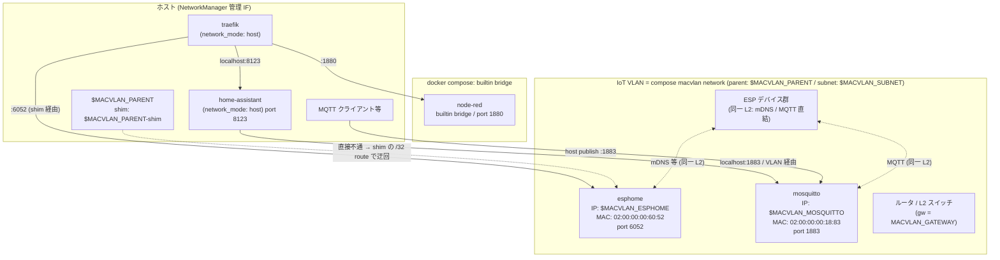

# IoT

## ネットワーク構成



macvlan で接続したコンテナとその親インターフェースを持つホストは、標準状態では直接通信できない。

そのため、`compose.yml` をデプロイ後に以下のコマンドを適用し、 macvlan shim を経由してアクセス可能にする。

macvlan コンテナの IP は DHCP ではなく Docker 内蔵 IPAM により割り当てられるため、compose 側で指定する。

## 前提条件

- `nmcli --version` が 1.28 以上 (macvlan profile は 1.28+ の nm で作成可能)
- コンテナ側の IP と MAC は compose で固定 (`ipv4_address` / `mac_address`) されていること
  (shim の `/32` route が IP 依存のため)

## macvlan shim 適用手順

### Network Manager (nmcli) の場合

環境変数の読み込み:

```sh
. "${REPO_PATH:-/opt/dc}/iot/.env"
```

ホストから macvlan へ通信するときに経由する仮想インターフェース (ルート用の shim) を作成:

```sh
sudo nmcli con add type macvlan \
  con-name "$MACVLAN_PARENT-shim" \
  ifname "$MACVLAN_PARENT-shim" \
  dev "$MACVLAN_PARENT" \
  mode bridge \
  mac 02:00:00:00:00:XX \
  ipv4.method manual \
  ipv4.addresses XXX.XXX.XXX.XXX/24 \
  ipv4.gateway '' \
  ipv6.method disabled
```

作成した仮想インターフェースにルートを追加:

(`/32` の longest-match が parent の connected `MACVLAN_SUBNET` より優先される。)
(subnet 全体を shim 経由にしないこと — host 自身の default gw (`MACVLAN_GATEWAY`) が parent から出なくなる)

```sh
sudo nmcli con mod "$MACVLAN_PARENT-shim" \
  +ipv4.routes "${MACVLAN_ESPHOME}/32 100" \
  +ipv4.routes "${MACVLAN_MOSQUITTO}/32 100"
```

アクティベーション:

```sh
sudo nmcli con up "$MACVLAN_PARENT-shim"
```

## 動作確認

host → macvlan コンテナ:

```sh
curl -m 5 -o /dev/null -w '%{http_code}\n' "http://${MACVLAN_ESPHOME}:6052"   # 200 なら OK
ping -c 2 "${MACVLAN_MOSQUITTO}"
```

traefik 経由:

```sh
curl -sk -o /dev/null -w '%{http_code}\n' "https://esphome.${DOMAIN:?}" \
  --resolve "esphome.${DOMAIN:?}:443:127.0.0.1"
```

`ip route show` で以下の route が存在することを常に確認:

```
${MACVLAN_ESPHOME}/32 dev ${MACVLAN_PARENT}-shim scope link metric 100
${MACVLAN_MOSQUITTO}/32 dev ${MACVLAN_PARENT}-shim scope link metric 100
```

## macvlan shim　の削除

### Network Manager (nmcli) の場合

環境変数の読み込み:

```sh
. "${REPO_PATH:-/opt/dc}/iot/.env"
```

インターフェースの削除

```sh
sudo nmcli con down "$MACVLAN_PARENT-shim"
sudo nmcli con delete "$MACVLAN_PARENT-shim"

# (任意) ARP/FDB の残骸を掃除
sudo ip neigh flush dev "$MACVLAN_PARENT-shim" 2>/dev/null || true
```
